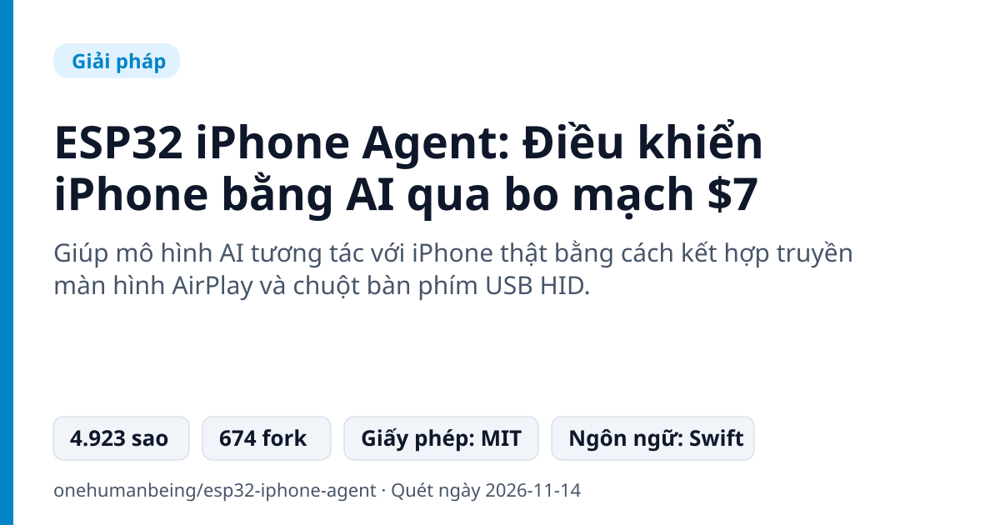
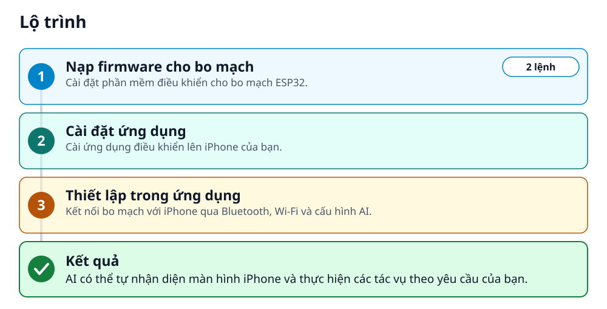
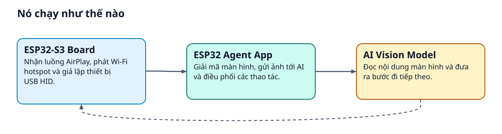
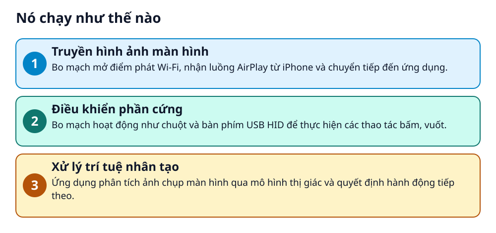

# ESP32 iPhone Agent: Điều khiển iPhone bằng AI qua bo mạch $7



> Để AI nhìn màn hình iPhone, bấm, vuốt và goz hộ bạn qua bo mạch ESP32 giá 7 USD mà không cần jailbreak.

**Giúp mô hình AI tương tác với iPhone thật bằng cách kết hợp truyền màn hình AirPlay và chuột bàn phím USB HID.**

## 🎯 Bạn sẽ làm ra được gì

AI có thể tự nhận diện màn hình iPhone và thực hiện các tác vụ theo yêu cầu của bạn.

## Vấn đề nó giải quyết

Nhiều người dùng muốn AI tự thao tác trên iPhone nhưng ngại việc cài đặt phức tạp, dùng máy Mac hay jailbreak thiết bị. Dự án này giải quyết bài toán đó bằng một bo mạch phần cứng giá rẻ cắm trực tiếp vào điện thoại.

> 💡 **Hình dung đời thường:** Giống như việc bạn gắn thêm một con mắt (AirPlay) và đôi tay robot (chuột USB) cho AI để nó tự bấm điện thoại thay bạn.

## Ai nên xem

- Người dùng muốn tự động hóa iPhone mà không cần jailbreak
- Lập trình viên muốn thử nghiệm AI computer-use trên thiết bị di động

## ⚠️ Lưu ý trước khi dùng

- Cần mua bo mạch phần cứng giá khoảng $7
- Điện thoại sẽ sử dụng dữ liệu di động khi kết nối Wi-Fi với bo mạch

## 🧰 Chuẩn bị trước khi bắt đầu

_Đánh dấu từng mục khi đã có đủ._

- [ ] **Bo mạch Seeed XIAO ESP32S3**: Khoảng $7  
  <sub>Căn cứ: `README`</sub>
- [ ] **iPhone**: Thiết bị iOS để chạy ứng dụng  
  <sub>Căn cứ: `README`</sub>
- [ ] **TestFlight**: Cài đặt ứng dụng ESP32 Agent  
  Liên kết trong README: [Try on TestFlight](https://testflight.apple.com/join/1xQHgJcA)  
  <sub>Căn cứ: `README`</sub>
- [ ] **arduino-cli**: Chỉ cần thiết nếu tự nạp firmware  
  Liên kết trong README: [arduino-cli](https://arduino.github.io/arduino-cli/)  
  <sub>Căn cứ: `README`</sub>

## 🗺️ Lộ trình



## 🪜 Làm theo từng bước

### Bước 1 · Nạp firmware cho bo mạch

**Mục đích:** Cài đặt phần mềm điều khiển cho bo mạch ESP32.

1. Cài đặt arduino-cli, ESP32 core 3.3.x và NimBLE-Arduino 2.5.x
2. Chạy lệnh nạp firmware trong terminal

_Gõ hoặc dán từng dòng, theo thứ tự._

```bash
arduino-cli lib install "NimBLE-Arduino@2.5.1"
hardware/flash.sh
```

✅ **Bạn sẽ thấy:** Firmware được nạp thành công vào bo mạch.

🩹 **Nếu không được:** Dùng cách nạp qua trình duyệt Chrome hoặc Edge nếu không dùng Mac.

<sub>Căn cứ: `README`</sub>

### Bước 2 · Cài đặt ứng dụng

**Mục đích:** Cài ứng dụng điều khiển lên iPhone của bạn.

1. Tham gia beta qua TestFlight trên iPhone
2. Cài đặt ứng dụng ESP32 Agent

🔗 Liên kết trong README: [Try on TestFlight](https://testflight.apple.com/join/1xQHgJcA)

✅ **Bạn sẽ thấy:** Ứng dụng xuất hiện trên màn hình điện thoại.

🩹 **Nếu không được:** Kiểm tra lại liên kết TestFlight.

<sub>Căn cứ: `README`</sub>

### Bước 3 · Thiết lập trong ứng dụng

**Mục đích:** Kết nối bo mạch với iPhone qua Bluetooth, Wi-Fi và cấu hình AI.

1. Cắm bo mạch vào iPhone và mở ứng dụng ESP32 Agent
2. Thực hiện 4 bước hướng dẫn: ghép nối Bluetooth, bật Screen Mirroring, bật AssistiveTouch và nhập khóa mô hình AI

✅ **Bạn sẽ thấy:** Ứng dụng kết nối thành công với bo mạch và sẵn sàng nhận lệnh.

🩹 **Nếu không được:** Kiểm tra lại kết nối cáp và nguồn điện của bo mạch.

<sub>Căn cứ: `README`</sub>

## ✔️ Kiểm tra kết quả

Nhập một mục tiêu ví dụ 'Open Settings and go to Wi-Fi' và nhấn Start để AI tự thực hiện trên iPhone.

## 🩹 Lỗi thường gặp

| Hiện tượng | Cách xử lý | Căn cứ |
|---|---|---|
| Free line busy or failing | Chuyển sang sử dụng API key riêng của bạn trong phần Settings › Model. | `README` |

## 🚀 Làm tiếp

- Chạy các tác vụ dài hơn
- Tùy chỉnh model lập kế hoạch và model hành động

## 🔍 Bên trong nó hoạt động ra sao





1. **Truyền hình ảnh màn hình**: Bo mạch mở điểm phát Wi-Fi, nhận luồng AirPlay từ iPhone và chuyển tiếp đến ứng dụng. _(Căn cứ: `README`)_
2. **Điều khiển phần cứng**: Bo mạch hoạt động như chuột và bàn phím USB HID để thực hiện các thao tác bấm, vuốt. _(Căn cứ: `README`)_
3. **Xử lý trí tuệ nhân tạo**: Ứng dụng phân tích ảnh chụp màn hình qua mô hình thị giác và quyết định hành động tiếp theo. _(Căn cứ: `README`)_

### Các mảnh ghép

| | Các mảnh ghép | Căn cứ |
|---|---|---|
| **ESP32-S3 Board** | Nhận luồng AirPlay, phát Wi-Fi hotspot và giả lập thiết bị USB HID. | `README` |
| **ESP32 Agent App** | Giải mã màn hình, gửi ảnh tới AI và điều phối các thao tác. | `README` |
| **AI Vision Model** | Đọc nội dung màn hình và đưa ra bước đi tiếp theo. | `README` |

## Học được gì từ thiết kế này

- Cách tích hợp phần cứng giá rẻ ESP32 với ứng dụng di động
- Cách xây dựng agent AI điều khiển giao diện người dùng qua màn hình và chuột ảo
- Cách sử dụng giao thức AirPlay để truyền tải hình ảnh không dây
- Cách quản lý vòng lặp hành động của mô hình thị giác trên thiết bị di động

## Từ khóa

- **AirPlay**: Giao thức truyền phát không dây màn hình iPhone lên bo mạch.
- **USB HID**: Chuẩn giao tiếp USB cho phép bo mạch điều khiển con trỏ và bàn phím như thiết bị ngoại vi.

---

Nguồn dữ kiện: [onehumanbeing/esp32-iphone-agent](https://github.com/onehumanbeing/esp32-iphone-agent) · Giấy phép: MIT · 4.923 sao · Quét ngày 2026-11-14

_Nội dung do AI tóm tắt từ README và cấu trúc repo; hãy đọc repo gốc trước khi dùng._
