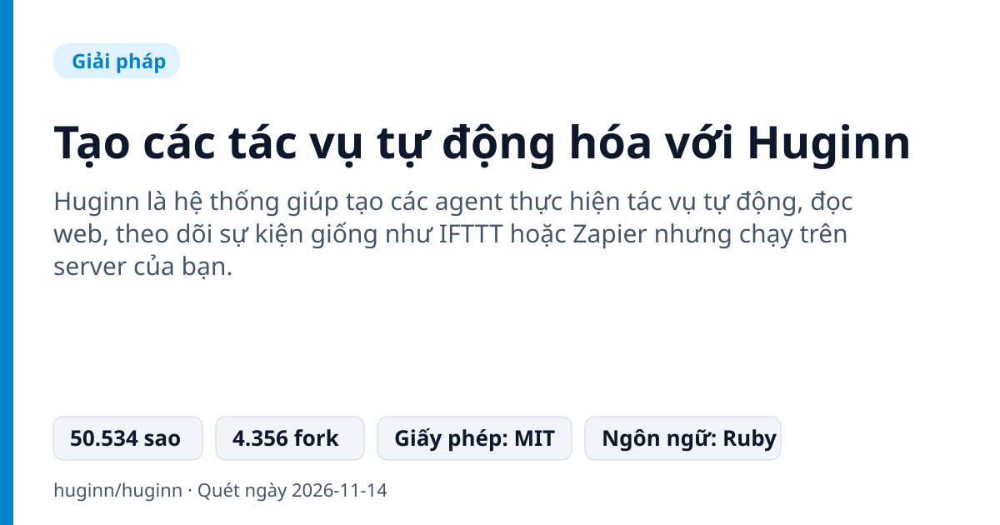
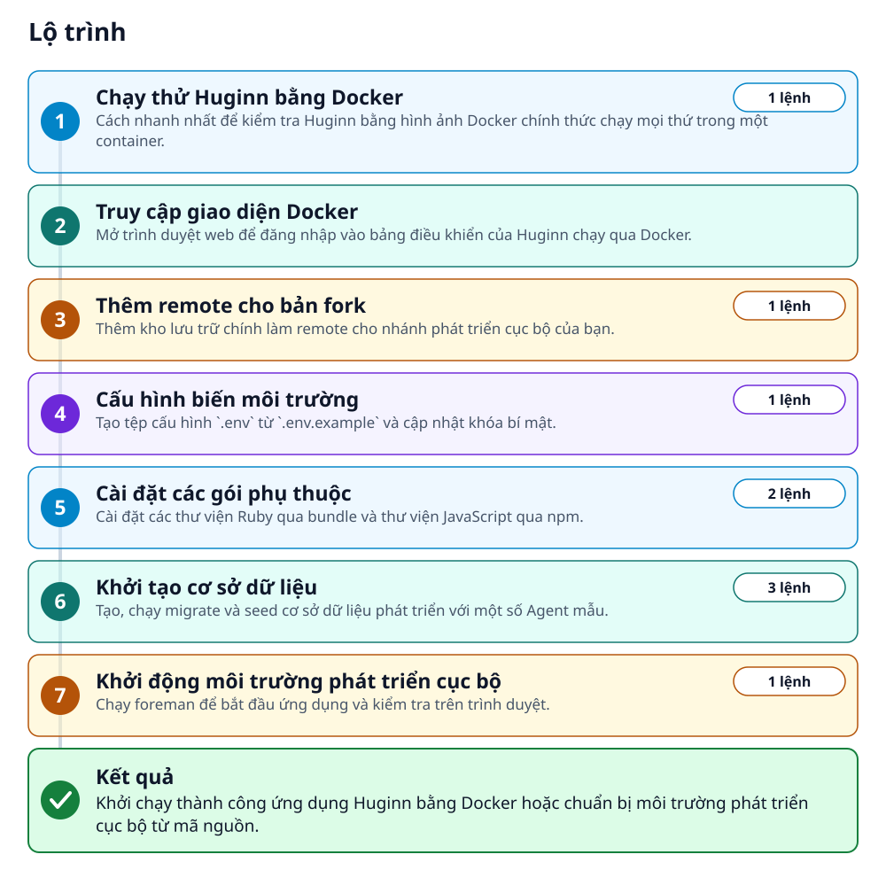
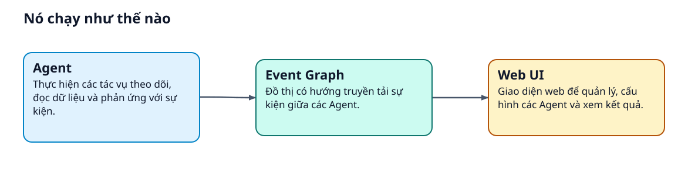
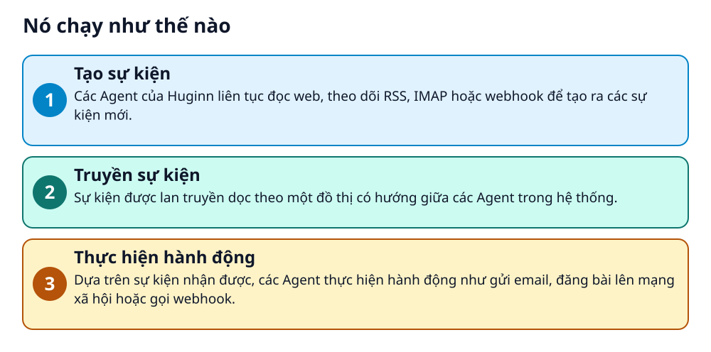

# Tạo các tác vụ tự động hóa với Huginn



> Xây dựng các agent tự động theo dõi web và hành động thay cho bạn trên server riêng.

**Huginn là hệ thống giúp tạo các agent thực hiện tác vụ tự động, đọc web, theo dõi sự kiện giống như IFTTT hoặc Zapier nhưng chạy trên server của bạn.**

## 🎯 Bạn sẽ làm ra được gì

Khởi chạy thành công ứng dụng Huginn bằng Docker hoặc chuẩn bị môi trường phát triển cục bộ từ mã nguồn.

## Vấn đề nó giải quyết

Bạn muốn tự động hóa các công việc lặp đi lặp lại trên mạng như cào dữ liệu web, theo dõi RSS, nhận thông báo thay đổi nhưng lo lắng về quyền riêng tư dữ liệu trên các dịch vụ bên thứ ba.

> 💡 **Hình dung đời thường:** Giống như việc bạn thuê một trợ lý ảo chăm chỉ, luôn túc trực ngày đêm để lướt web, đọc tin tức và báo cáo ngay cho bạn khi có thông tin quan trọng.

## Ai nên xem

- Nhân viên văn phòng muốn tự động hóa công việc kiểm tra thông tin trên web.
- Lập trình viên muốn tự chủ dữ liệu cá nhân thay vì dùng dịch vụ bên thứ ba.
- Người thích tự xây dựng các hệ thống thông báo và tích hợp API.

## ⚠️ Lưu ý trước khi dùng

- Yêu cầu kiến thức cơ bản về dòng lệnh và quản trị server khi chạy thực tế.
- Không giữ worker chạy miễn phí trên các nền tảng đám mây quản lý.

## 🧰 Chuẩn bị trước khi bắt đầu

_Đánh dấu từng mục khi đã có đủ._

- [ ] **Docker**: Cần thiết để chạy thử Huginn nhanh chóng bằng container.  
  <sub>Căn cứ: `README`</sub>
- [ ] **MySQL hoặc PostgreSQL**: Cần thiết nếu bạn muốn phát triển cục bộ từ mã nguồn.  
  <sub>Căn cứ: `README`</sub>
- [ ] **Node.js**: Cần thiết cho các thư viện giao diện như Font Awesome.  
  <sub>Căn cứ: `README`</sub>

## 🗺️ Lộ trình



## 🪜 Làm theo từng bước

### Bước 1 · Chạy thử Huginn bằng Docker

**Mục đích:** Cách nhanh nhất để kiểm tra Huginn bằng hình ảnh Docker chính thức chạy mọi thứ trong một container.

1. Mở terminal và chạy lệnh Docker để khởi động container Huginn.

_Gõ hoặc dán từng dòng, theo thứ tự._

```bash
docker run -it -p 3000:3000 ghcr.io/huginn/huginn
```

✅ **Bạn sẽ thấy:** Container khởi động và in mật khẩu admin một lần vào log.

<sub>Căn cứ: `README`</sub>

### Bước 2 · Truy cập giao diện Docker

**Mục đích:** Mở trình duyệt web để đăng nhập vào bảng điều khiển của Huginn chạy qua Docker.

1. Mở trình duyệt và truy cập địa chỉ localhost ở cổng 3000.
2. Đăng nhập với tài khoản admin và mật khẩu được in trong log của container.

🔗 Mở địa chỉ: `http://localhost:3000/`

✅ **Bạn sẽ thấy:** Giao diện Huginn hiển thị trên trình duyệt.

<sub>Căn cứ: `README`</sub>

### Bước 3 · Thêm remote cho bản fork

**Mục đích:** Thêm kho lưu trữ chính làm remote cho nhánh phát triển cục bộ của bạn.

1. Mở terminal và chạy lệnh git remote add để liên kết với kho chính.

```bash
git remote add upstream https://github.com/huginn/huginn.git
```

🔗 Liên kết trong README: [github.com](https://github.com/huginn/huginn.git)

<sub>Căn cứ: `README`</sub>

### Bước 4 · Cấu hình biến môi trường

**Mục đích:** Tạo tệp cấu hình `.env` từ `.env.example` và cập nhật khóa bí mật.

1. Sao chép tệp `.env.example` thành `.env` và chỉnh sửa biến `APP_SECRET_TOKEN`.

```bash
cp .env.example .env
```

<sub>Căn cứ: `README`</sub>

### Bước 5 · Cài đặt các gói phụ thuộc

**Mục đích:** Cài đặt các thư viện Ruby qua bundle và thư viện JavaScript qua npm.

1. Chạy lệnh cài đặt bundle và npm install trên terminal.

```bash
bundle
npm install
```

<sub>Căn cứ: `README`</sub>

### Bước 6 · Khởi tạo cơ sở dữ liệu

**Mục đích:** Tạo, chạy migrate và seed cơ sở dữ liệu phát triển với một số Agent mẫu.

1. Chạy các lệnh rake trên terminal để thiết lập database.

```bash
bundle exec rake db:create
bundle exec rake db:migrate
bundle exec rake db:seed
```

<sub>Căn cứ: `README`</sub>

### Bước 7 · Khởi động môi trường phát triển cục bộ

**Mục đích:** Chạy foreman để bắt đầu ứng dụng và kiểm tra trên trình duyệt.

1. Chạy lệnh foreman start trên terminal và mở địa chỉ localhost cổng 3000.

```bash
bundle exec foreman start
```

🔗 Mở địa chỉ: `http://localhost:3000/`

✅ **Bạn sẽ thấy:** Ứng dụng chạy và có thể truy cập qua trình duyệt với tài khoản admin.

<sub>Căn cứ: `README`</sub>

## ✔️ Kiểm tra kết quả

Truy cập thành công trang quản trị Huginn tại cổng 3000 và đăng nhập được bằng tài khoản admin.

## 🚀 Làm tiếp

- Đọc wiki để tìm hiểu ví dụ sử dụng và tạo các Agent mới.
- Cấu hình cơ sở dữ liệu bên ngoài và lưu trữ bền vững theo tài liệu Docker.

## 🔍 Bên trong nó hoạt động ra sao





1. **Tạo sự kiện**: Các Agent của Huginn liên tục đọc web, theo dõi RSS, IMAP hoặc webhook để tạo ra các sự kiện mới. _(Căn cứ: `README`)_
2. **Truyền sự kiện**: Sự kiện được lan truyền dọc theo một đồ thị có hướng giữa các Agent trong hệ thống. _(Căn cứ: `README`)_
3. **Thực hiện hành động**: Dựa trên sự kiện nhận được, các Agent thực hiện hành động như gửi email, đăng bài lên mạng xã hội hoặc gọi webhook. _(Căn cứ: `README`)_

### Các mảnh ghép

| | Các mảnh ghép | Căn cứ |
|---|---|---|
| **Agent** | Thực hiện các tác vụ theo dõi, đọc dữ liệu và phản ứng với sự kiện. | `README` |
| **Event Graph** | Đồ thị có hướng truyền tải sự kiện giữa các Agent. | `README` |
| **Web UI** | Giao diện web để quản lý, cấu hình các Agent và xem kết quả. | `README` |

## Học được gì từ thiết kế này

- Cách tự động hóa các tác vụ lặp đi lặp lại trên nền tảng self-hosted.
- Mô hình lập trình dựa trên sự kiện và đồ thị Agent.
- Cách vận hành ứng dụng Ruby trên môi trường Docker hoặc local.

## Từ khóa

- **Agent**: Một thành phần trong Huginn chịu trách nhiệm thực hiện một nhiệm vụ cụ thể như đọc web, theo dõi RSS hay gửi thông báo.
- **Event**: Dữ liệu được tạo ra và truyền đi giữa các Agent trong hệ thống.

---

Nguồn dữ kiện: [huginn/huginn](https://github.com/huginn/huginn) · Giấy phép: MIT · 50.534 sao · Quét ngày 2026-11-14

_Nội dung do AI tóm tắt từ README và cấu trúc repo; hãy đọc repo gốc trước khi dùng._
