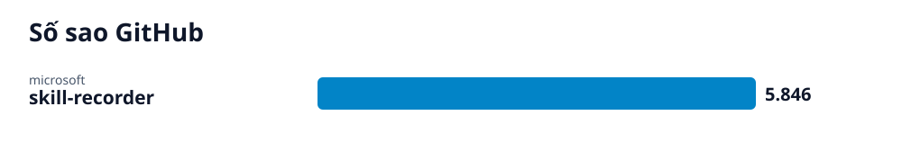

# Radar GitHub · 2026-11-18

## Các repo của lần quét này

- **[Biến thao tác màn hình thành kỹ năng AI với Skill Recorder](skill-recorder/vi.md)** (Giải pháp) — Ứng dụng máy tính ghi lại thao tác màn hình và dùng GitHub Copilot CLI để tái cấu trúc thành kỹ năng Skill hoặc quy trình tự động hóa cho AI agent.
  - 🎯 Khởi chạy thành công Skill Recorder từ mã nguồn, ghi lại thao tác và xuất ra tệp quy trình Skill hoặc Automation cho AI agent. · 🪜 6 bước
