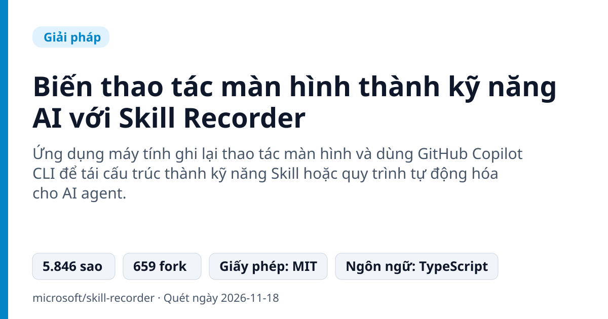
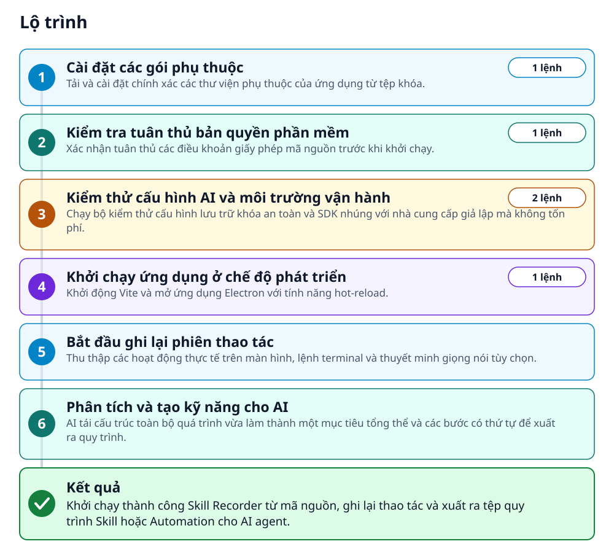
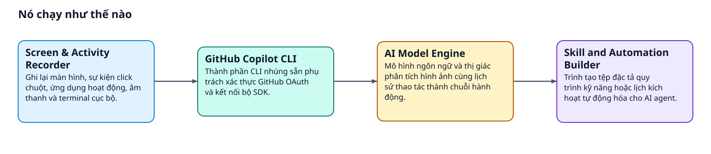
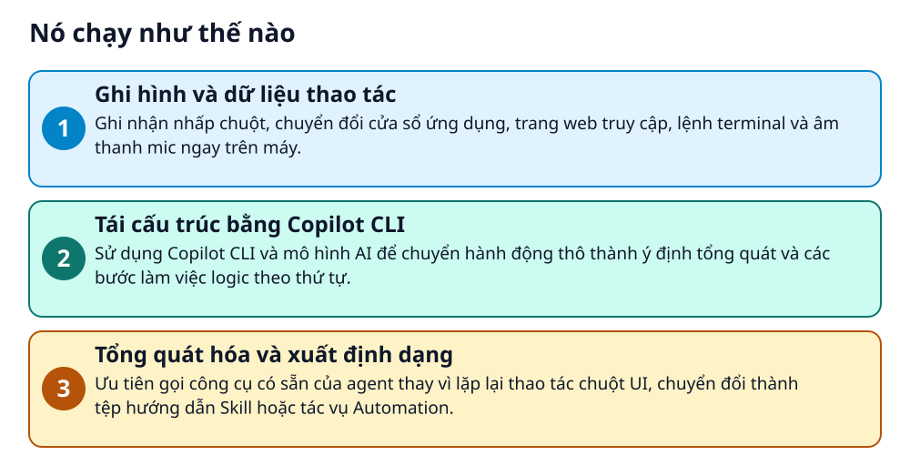

# Biến thao tác màn hình thành kỹ năng AI với Skill Recorder



> Làm mẫu một lần trên màn hình, AI tự học thành quy trình kỹ năng có thể lặp lại tự động.

**Ứng dụng máy tính ghi lại thao tác màn hình và dùng GitHub Copilot CLI để tái cấu trúc thành kỹ năng Skill hoặc quy trình tự động hóa cho AI agent.**

## 🎯 Bạn sẽ làm ra được gì

Khởi chạy thành công Skill Recorder từ mã nguồn, ghi lại thao tác và xuất ra tệp quy trình Skill hoặc Automation cho AI agent.

## Vấn đề nó giải quyết

Người dùng văn phòng và lập trình viên phải lặp đi lặp lại các tác vụ thủ công nhiều bước trên máy tính. Việc tự viết prompt hoặc mã lệnh chi tiết cho AI agent mô phỏng lại các bước này rất tốn thời gian và dễ sai sót.

> 💡 **Hình dung đời thường:** Giống như bạn làm mẫu một công việc cho nhân viên mới xem qua vai, rồi người đó tự chép lại thành bản hướng dẫn quy trình chuẩn để làm theo những lần sau.

## Ai nên xem

- Người làm văn phòng muốn biến các chuỗi thao tác thường ngày thành quy trình cho trợ lý AI
- Lập trình viên muốn tạo kỹ năng Skill cho Microsoft Scout, Copilot Cowork hoặc Copilot Studio
- Người xây dựng agent AI cần chuyển đổi thao tác người dùng thành công cụ gọi lệnh chuẩn native

## ⚠️ Lưu ý trước khi dùng

- Không bảo vệ bí mật tự động: dữ liệu màn hình sẽ gửi tới AI khi bấm Analyze nên phải tự tránh nhập mật khẩu hoặc token
- Tính năng BYOM vẫn gửi yêu cầu tới endpoint từ xa và tính phí nhà cung cấp, không phải xử lý ngoại tuyến
- Phát triển từ mã nguồn đòi hỏi Node.js 24

## 🧰 Chuẩn bị trước khi bắt đầu

_Đánh dấu từng mục khi đã có đủ._

- [ ] **Môi trường Node.js 24**: Bắt buộc phiên bản Node.js 24 để xây dựng và chạy ứng dụng từ mã nguồn.  
  <sub>Căn cứ: `README`</sub>
- [ ] **Hệ điều hành được hỗ trợ**: macOS (nền tảng chính), Windows 11 (x64 hoặc ARM64), hoặc Ubuntu.  
  <sub>Căn cứ: `README`</sub>
- [ ] **Tài khoản GitHub Copilot hoặc API key nhà cung cấp AI**: Cần tài khoản GitHub có Copilot access hoặc API key hỗ trợ image input và tool calling (OpenAI, Anthropic, Azure OpenAI, Foundry...).  
  <sub>Căn cứ: `README`</sub>

## 🗺️ Lộ trình



## 🪜 Làm theo từng bước

### Bước 1 · Cài đặt các gói phụ thuộc

**Mục đích:** Tải và cài đặt chính xác các thư viện phụ thuộc của ứng dụng từ tệp khóa.

1. Mở terminal tại thư mục mã nguồn đã tải về của dự án.
2. Chạy lệnh cài đặt npm ci.

_Gõ hoặc dán từng dòng, theo thứ tự._

```bash
npm ci
```

<sub>Căn cứ: `README`</sub>

### Bước 2 · Kiểm tra tuân thủ bản quyền phần mềm

**Mục đích:** Xác nhận tuân thủ các điều khoản giấy phép mã nguồn trước khi khởi chạy.

1. Nhập lệnh kiểm tra bản quyền vào terminal.

```bash
npm run compliance:licenses
```

<sub>Căn cứ: `README`</sub>

### Bước 3 · Kiểm thử cấu hình AI và môi trường vận hành

**Mục đích:** Chạy bộ kiểm thử cấu hình lưu trữ khóa an toàn và SDK nhúng với nhà cung cấp giả lập mà không tốn phí.

1. Chạy lần lượt các lệnh kiểm thử AI trong terminal.

```bash
npm run test:ai
npm run test:ai:runtime
```

<sub>Căn cứ: `README`</sub>

### Bước 4 · Khởi chạy ứng dụng ở chế độ phát triển

**Mục đích:** Khởi động Vite và mở ứng dụng Electron với tính năng hot-reload.

1. Chạy lệnh npm run dev trong terminal.
2. Trên macOS, cấp quyền Screen Recording khi hệ điều hành hiển thị lời nhắc.

```bash
npm run dev
```

✅ **Bạn sẽ thấy:** Giao diện chính của Skill Recorder xuất hiện sẵn sàng cho việc ghi hình.

<sub>Căn cứ: `README`</sub>

### Bước 5 · Bắt đầu ghi lại phiên thao tác

**Mục đích:** Thu thập các hoạt động thực tế trên màn hình, lệnh terminal và thuyết minh giọng nói tùy chọn.

1. Bấm nút Record hoặc nhấn tổ hợp phím ⌘⇧R (trên macOS) / Ctrl+Shift+R (trên Windows) từ bất kỳ đâu.
2. Thực hiện công việc cần làm trên màn hình mà không nhập mật khẩu hay thông tin bí mật.
3. Sử dụng thanh điều khiển nổi để bật tắt mic hoặc terminal phiên khi cần, sau đó kết thúc phiên.

✅ **Bạn sẽ thấy:** Thanh điều khiển trạng thái ghi hình, mic và terminal hiển thị nổi trên màn hình.

<sub>Căn cứ: `README`</sub>

### Bước 6 · Phân tích và tạo kỹ năng cho AI

**Mục đích:** AI tái cấu trúc toàn bộ quá trình vừa làm thành một mục tiêu tổng thể và các bước có thứ tự để xuất ra quy trình.

1. Bấm nút Analyze trong ứng dụng sau khi dừng ghi.
2. Nếu chưa thiết lập AI, chọn GitHub authentication để đăng nhập trình duyệt hoặc chọn Bring your own model để nhập API key.
3. Kiểm tra xem trước nội dung tệp quy trình và chọn tạo reusable Skill hoặc scheduled Automation.

✅ **Bạn sẽ thấy:** Tạo thành công quy trình Skill tái sử dụng hoặc cấu hình Automation cho agent.

🩹 **Nếu không được:** Nếu đăng nhập trình duyệt lỗi, sử dụng lệnh thủ công hiển thị trên màn hình với PowerShell hoặc terminal để đăng nhập và thử phân tích lại.

<sub>Căn cứ: `README`</sub>

## ✔️ Kiểm tra kết quả

Xem trước được toàn bộ nội dung tệp văn bản quy trình (bao gồm cả frontmatter) qua nút xem trước trước khi cài đặt hoặc xuất ra.

## 🩹 Lỗi thường gặp

| Hiện tượng | Cách xử lý | Căn cứ |
|---|---|---|
| Secure space is unavailable. The Key will be saved in-memory and will be re-asked next time. | Không gian bảo mật của hệ điều hành không khả dụng; API key vẫn hoạt động trong phiên hiện tại nhưng sẽ cần nhập lại vào lần sau. | `README` |
| Quá trình đăng nhập trình duyệt bằng GitHub Copilot bị thất bại hoặc hết hạn 5 phút | Dùng lệnh thủ công được ứng dụng hiển thị (chạy trên PowerShell nếu ở Windows), sau đó quay lại ứng dụng và tự bấm thử lại Analyze. | `README` |

## 🚀 Làm tiếp

- Mở AI connection trong Sessions để đổi nhà cung cấp mô hình (OpenAI, Anthropic, Azure OpenAI)
- Cấu hình lịch chạy tự động hoặc trigger cho quy trình Automation vừa tạo

## 🔍 Bên trong nó hoạt động ra sao





1. **Ghi hình và dữ liệu thao tác**: Ghi nhận nhấp chuột, chuyển đổi cửa sổ ứng dụng, trang web truy cập, lệnh terminal và âm thanh mic ngay trên máy. _(Căn cứ: `README`)_
2. **Tái cấu trúc bằng Copilot CLI**: Sử dụng Copilot CLI và mô hình AI để chuyển hành động thô thành ý định tổng quát và các bước làm việc logic theo thứ tự. _(Căn cứ: `README`)_
3. **Tổng quát hóa và xuất định dạng**: Ưu tiên gọi công cụ có sẵn của agent thay vì lặp lại thao tác chuột UI, chuyển đổi thành tệp hướng dẫn Skill hoặc tác vụ Automation. _(Căn cứ: `README`)_

### Các mảnh ghép

| | Các mảnh ghép | Căn cứ |
|---|---|---|
| **Screen & Activity Recorder** | Ghi lại màn hình, sự kiện click chuột, ứng dụng hoạt động, âm thanh và terminal cục bộ. | `README` |
| **GitHub Copilot CLI** | Thành phần CLI nhúng sẵn phụ trách xác thực GitHub OAuth và kết nối bộ SDK. | `README` |
| **AI Model Engine** | Mô hình ngôn ngữ và thị giác phân tích hình ảnh cùng lịch sử thao tác thành chuỗi hành động. | `README` |
| **Skill and Automation Builder** | Trình tạo tệp đặc tả quy trình kỹ năng hoặc lịch kích hoạt tự động hóa cho AI agent. | `README` |

## Học được gì từ thiết kế này

- Cách tổng quát hóa từ một lần làm mẫu sang công cụ native thay vì bấm lại giao diện máy tính
- Mô hình tích hợp Copilot CLI vào ứng dụng desktop Electron để xử lý xác thực Web OAuth
- Cơ chế bảo vệ API key cục bộ bằng hệ thống lưu trữ khóa bảo mật của hệ điều hành

## Từ khóa

- **BYOM**: Bring your own model: Cơ chế tự cung cấp API key của các dịch vụ như OpenAI, Anthropic, Azure OpenAI mà không cần tài khoản Copilot.
- **Skill**: Tài liệu chứa hướng dẫn quy trình và thuộc tính frontmatter để AI agent đọc và thực thi khi được yêu cầu.

---

Nguồn dữ kiện: [microsoft/skill-recorder](https://github.com/microsoft/skill-recorder) · Giấy phép: MIT · 5.846 sao · Quét ngày 2026-11-18

_Nội dung do AI tóm tắt từ README và cấu trúc repo; hãy đọc repo gốc trước khi dùng._
