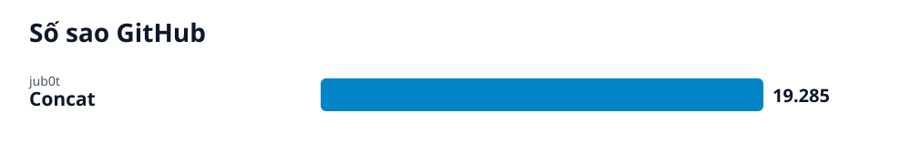

# Radar GitHub · 2026-11-21

## Các repo của lần quét này

- **[Trình chỉnh sửa video mã nguồn mở miễn phí Concat](concat/vi.md)** (Phần mềm) — Concat là trình chỉnh sửa video mã nguồn mở miễn phí, chạy hoàn toàn cục bộ, hỗ trợ đa nền tảng và có thể điều khiển qua MCP.
  - 🎯 Cài đặt và chạy được trình chỉnh sửa video Concat hoặc mã nguồn của nó trên máy tính của bạn. · 🪜 5 bước
