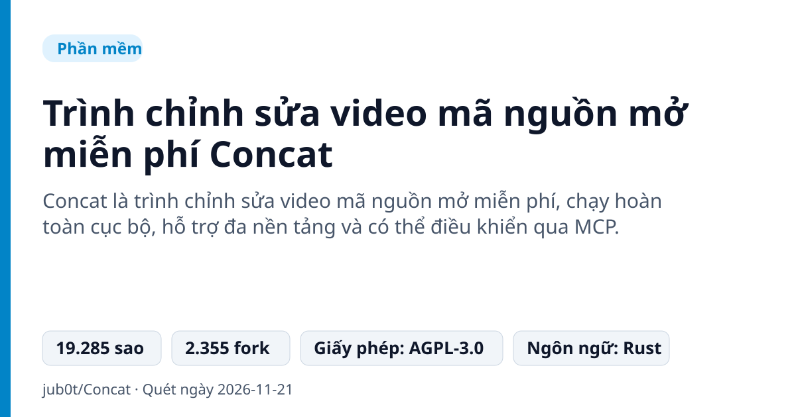
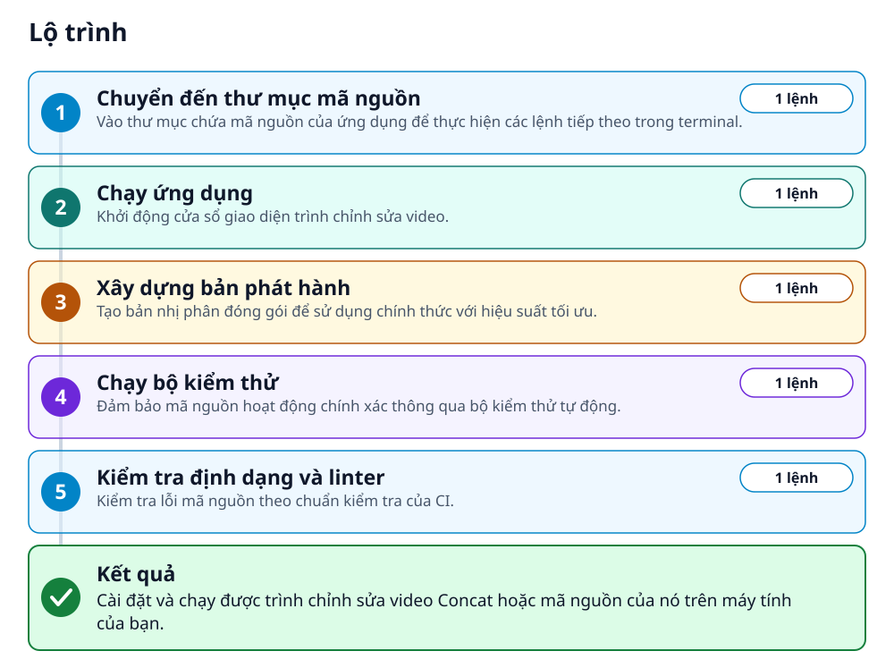
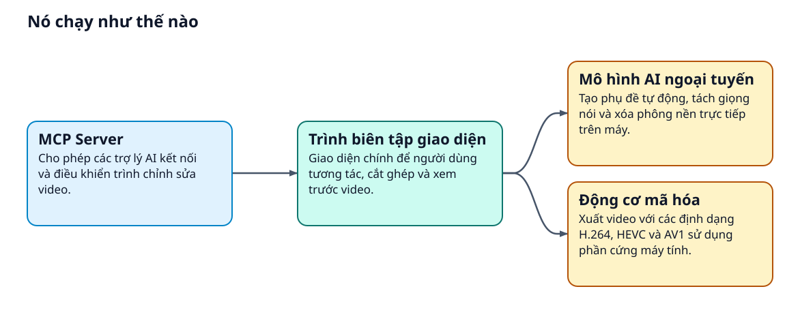
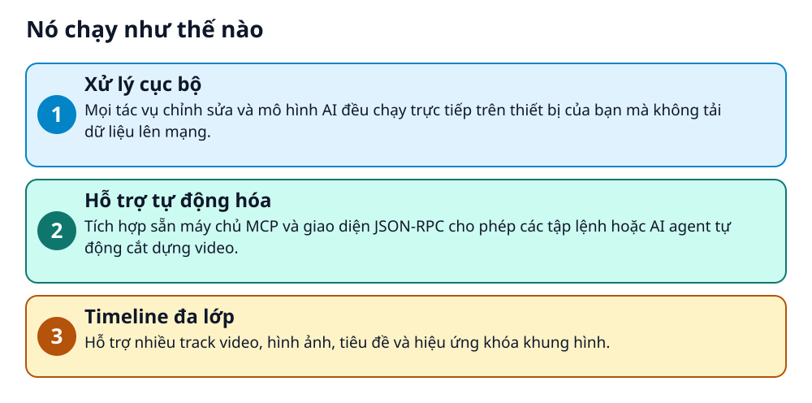

# Trình chỉnh sửa video mã nguồn mở miễn phí Concat



> Chỉnh sửa video hoàn toàn ngoại tuyến trên máy tính với Concat mà không cần tài khoản hay hình mờ.

**Concat là trình chỉnh sửa video mã nguồn mở miễn phí, chạy hoàn toàn cục bộ, hỗ trợ đa nền tảng và có thể điều khiển qua MCP.**

## 🎯 Bạn sẽ làm ra được gì

Cài đặt và chạy được trình chỉnh sửa video Concat hoặc mã nguồn của nó trên máy tính của bạn.

## Vấn đề nó giải quyết

Nhiều phần mềm chỉnh sửa video hiện nay yêu cầu tạo tài khoản, chèn hình mờ hoặc tải tệp lên đám mây, làm mất quyền riêng tư của người dùng. Người làm sáng tạo nội dung trên điện thoại và máy tính cần một công cụ miễn phí, chạy ngoại tuyến hoàn toàn trên thiết bị của mình.

> 💡 **Hình dung đời thường:** Giống như việc bạn có một phòng thu phim riêng tư ngay trong nhà mình, nơi mọi thứ từ máy cắt phim đến hiệu ứng đều nằm trên bàn của bạn và không ai nhìn thấy.

## Ai nên xem

- Người sáng tạo nội dung video ngắn
- Lập trình viên muốn tự động hóa việc chỉnh sửa video
- Người dùng coi trọng quyền riêng tư và muốn chỉnh sửa ngoại tuyến

## ⚠️ Lưu ý trước khi dùng

- Phần mềm đang trong giai đoạn thử nghiệm (beta) nên có thể còn một số lỗi nhỏ.
- Bản dựng trên Windows chưa được ký số (unsigned), cần thao tác bỏ qua cảnh báo bảo mật.
- Yêu cầu cấu hình phần cứng tối thiểu đáp ứng để chạy mô hình AI và mã hóa video 4K.

## 🧰 Chuẩn bị trước khi bắt đầu

_Đánh dấu từng mục khi đã có đủ._

- [ ] **Rust 1.93 hoặc mới hơn**: Xem rust-version trong src/Cargo.toml  
  <sub>Căn cứ: `README.md`</sub>
- [ ] **Thư viện phát triển FFmpeg 7+**: Cần thiết khi xây dựng từ mã nguồn  
  Liên kết trong README: [FFmpeg's Windows downloads](https://ffmpeg.org/download.html#build-windows)  
  <sub>Căn cứ: `README.md`</sub>
- [ ] **Trình biên dịch C++ và cmake**: Dùng để biên dịch các thành phần mã nguồn  
  <sub>Căn cứ: `README.md`</sub>

## 🗺️ Lộ trình



## 🪜 Làm theo từng bước

### Bước 1 · Chuyển đến thư mục mã nguồn

**Mục đích:** Vào thư mục chứa mã nguồn của ứng dụng để thực hiện các lệnh tiếp theo trong terminal.

1. Mở terminal và chuyển vào thư mục src.

_Gõ hoặc dán từng dòng, theo thứ tự._

```bash
cd src
```

<sub>Căn cứ: `README.md`</sub>

### Bước 2 · Chạy ứng dụng

**Mục đích:** Khởi động cửa sổ giao diện trình chỉnh sửa video.

1. Gõ lệnh chạy ứng dụng trong terminal.

```bash
cargo run -p concat
```

<sub>Căn cứ: `README.md`</sub>

### Bước 3 · Xây dựng bản phát hành

**Mục đích:** Tạo bản nhị phân đóng gói để sử dụng chính thức với hiệu suất tối ưu.

1. Chạy lệnh build bản app trong terminal.

```bash
cargo build --profile app -p concat
```

<sub>Căn cứ: `README.md`</sub>

### Bước 4 · Chạy bộ kiểm thử

**Mục đích:** Đảm bảo mã nguồn hoạt động chính xác thông qua bộ kiểm thử tự động.

1. Chạy lệnh test trong terminal.

```bash
cargo test
```

<sub>Căn cứ: `README.md`</sub>

### Bước 5 · Kiểm tra định dạng và linter

**Mục đích:** Kiểm tra lỗi mã nguồn theo chuẩn kiểm tra của CI.

1. Chạy lệnh kiểm tra định dạng và clippy trong terminal.

```bash
cargo fmt --check && cargo clippy --all-targets -- -D warnings
```

<sub>Căn cứ: `README.md`</sub>

## ✔️ Kiểm tra kết quả

Cửa sổ giao diện chính của trình chỉnh sửa video Concat hiện lên trên màn hình và các lệnh biên dịch chạy thành công.

## 🚀 Làm tiếp

- Khám phá các tính năng cắt ghép, phụ đề tự động và hiệu ứng
- Tìm hiểu cách kết nối AI agent qua MCP

## 🔍 Bên trong nó hoạt động ra sao





1. **Xử lý cục bộ**: Mọi tác vụ chỉnh sửa và mô hình AI đều chạy trực tiếp trên thiết bị của bạn mà không tải dữ liệu lên mạng. _(Căn cứ: `README.md`)_
2. **Hỗ trợ tự động hóa**: Tích hợp sẵn máy chủ MCP và giao diện JSON-RPC cho phép các tập lệnh hoặc AI agent tự động cắt dựng video. _(Căn cứ: `README.md`)_
3. **Timeline đa lớp**: Hỗ trợ nhiều track video, hình ảnh, tiêu đề và hiệu ứng khóa khung hình. _(Căn cứ: `README.md`)_

### Các mảnh ghép

| | Các mảnh ghép | Căn cứ |
|---|---|---|
| **Trình biên tập giao diện** | Giao diện chính để người dùng tương tác, cắt ghép và xem trước video. | `README.md` |
| **Mô hình AI ngoại tuyến** | Tạo phụ đề tự động, tách giọng nói và xóa phông nền trực tiếp trên máy. | `README.md` |
| **MCP Server** | Cho phép các trợ lý AI kết nối và điều khiển trình chỉnh sửa video. | `README.md` |
| **Động cơ mã hóa** | Xuất video với các định dạng H.264, HEVC và AV1 sử dụng phần cứng máy tính. | `README.md` |

## Học được gì từ thiết kế này

- Cách vận dụng phần mềm mã nguồn mở để chỉnh sửa video phi tập trung
- Cách chạy các mô hình AI hoàn toàn trên thiết bị cá nhân
- Cách tích hợp công cụ chỉnh sửa video với các tác vụ lập trình tự động

## Từ khóa

- **MCP**: Model Context Protocol, giao thức giúp kết nối các AI agent với ứng dụng.
- **JSON-RPC**: Giao thức gọi thủ tục từ xa sử dụng định dạng JSON cho kịch bản tự động hóa.
- **Local-first**: Kiến trúc ưu tiên xử lý và lưu trữ dữ liệu trực tiếp trên thiết bị cá nhân.

---

Nguồn dữ kiện: [jub0t/Concat](https://github.com/jub0t/Concat) · Giấy phép: AGPL-3.0 · 19.285 sao · Quét ngày 2026-11-21

_Nội dung do AI tóm tắt từ README và cấu trúc repo; hãy đọc repo gốc trước khi dùng._
