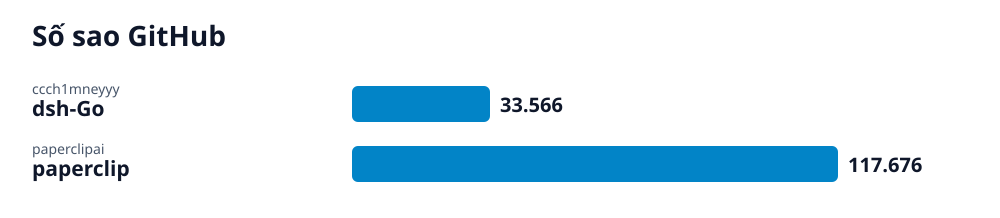

# Radar GitHub · 2026-11-28

## Các repo của lần quét này

- **[Dsh-Go: Chạy DeepSeek Harness Trên Điện Thoại Android](dsh-go/vi.md)** (AI) — Ứng dụng Android chạy môi trường Linux và DeepSeek Harness ngay trên máy, hỗ trợ điều khiển từ xa, giao diện web,桌宠 và phím tắt.
  - 🎯 Biên dịch thành công tệp APK của Dsh-Go cho kiến trúc arm64 trên Linux x86_64. · 🪜 5 bước
- **[Paperclip - Quản lý AI Agents tại nơi làm việc](paperclip/vi.md)** (AI) — Paperclip là ứng dụng mã nguồn mở để quản lý các tác nhân AI tại nơi làm việc với sơ đồ tổ chức, ngân sách và phân công.
  - 🎯 Khởi chạy giao diện và API của Paperclip tại localhost:3100 với cơ sở dữ liệu tích hợp sẵn. · 🪜 4 bước
