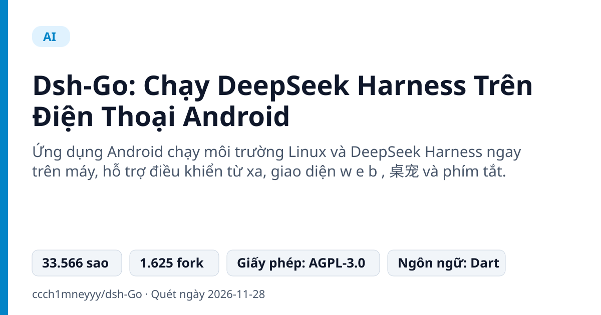
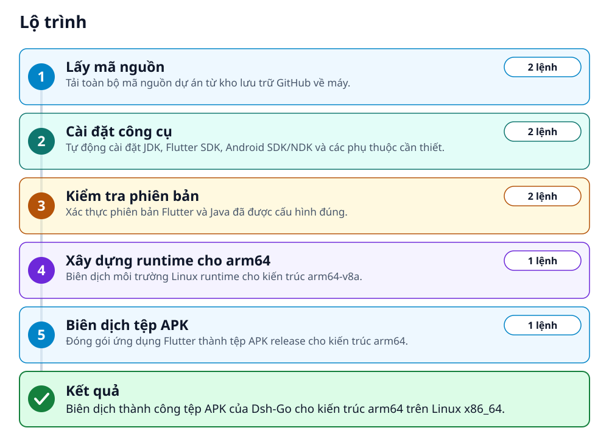
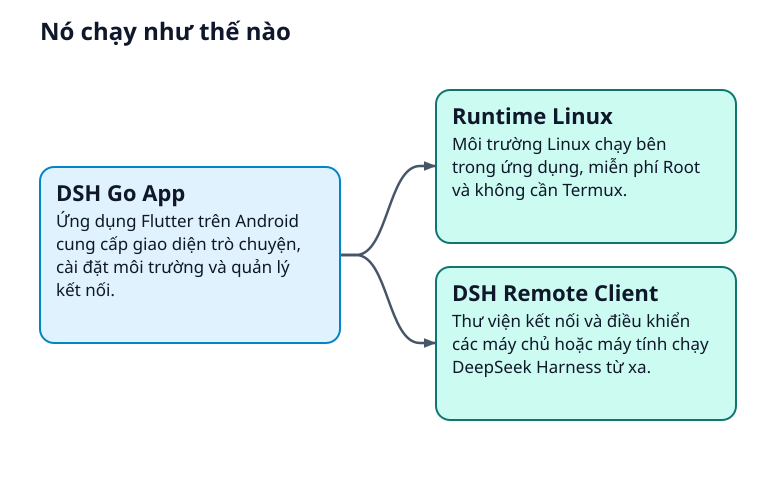
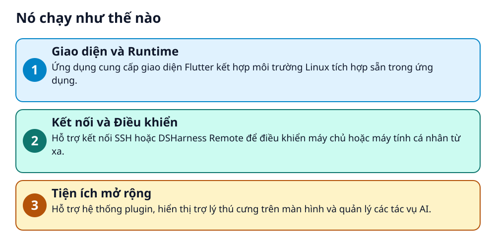

# Dsh-Go: Chạy DeepSeek Harness Trên Điện Thoại Android



> Đưa DeepSeek Harness vào túi quần: chạy native trên Android hoặc điều khiển máy tính của bạn từ xa.

**Ứng dụng Android chạy môi trường Linux và DeepSeek Harness ngay trên máy, hỗ trợ điều khiển từ xa, giao diện web,桌宠 và phím tắt.**

## 🎯 Bạn sẽ làm ra được gì

Biên dịch thành công tệp APK của Dsh-Go cho kiến trúc arm64 trên Linux x86_64.

## Vấn đề nó giải quyết

Người dùng muốn sử dụng DeepSeek Harness trên thiết bị di động nhưng bị giới hạn bởi môi trường dòng lệnh phức tạp hoặc cần một giải pháp điều khiển máy tính từ xa tiện lợi. Việc cài đặt thủ công qua Termux đôi khi khó khăn và thiếu giao diện trực quan thân thiện.

> 💡 **Hình dung đời thường:** Giống như việc lắp một chiếc động cơ xe hơi mạnh mẽ vào một bộ điều khiển cầm tay nhỏ gọn, vừa có thể tự chạy vừa cất gọn trong túi áo.

## Ai nên xem

- Lập trình viên muốn sử dụng DeepSeek Harness trực tiếp trên thiết bị Android
- Người dùng cần công cụ điều khiển máy tính hoặc máy chủ từ xa thông qua AI agent
- Nhà phát triển ứng dụng di động quan tâm đến Flutter và tích hợp Linux runtime

## ⚠️ Lưu ý trước khi dùng

- Dự án thuộc bên thứ ba không chính thức liên quan đến DeepSeek
- Yêu cầu thiết bị Android 8.0 trở lên và cần khoảng 1 GB dung lượng trống cho runtime
- Sử dụng AI agent và các công cụ thực thi lệnh có thể tiềm ẩn rủi ro về bảo mật dữ liệu nếu không cẩn thận

## 🧰 Chuẩn bị trước khi bắt đầu

_Đánh dấu từng mục khi đã có đủ._

- [ ] **Linux x86_64**: Môi trường hệ điều hành Linux x86_64 để build mã nguồn.  
  <sub>Căn cứ: `README`</sub>
- [ ] **Bash, Git, cURL và các công cụ**: Chuẩn bị Bash, Git, curl, tar, unzip, xz, Python 3, zstd, file và các lệnh GNU phổ biến.  
  <sub>Căn cứ: `README`</sub>

## 🗺️ Lộ trình



## 🪜 Làm theo từng bước

### Bước 1 · Lấy mã nguồn

**Mục đích:** Tải toàn bộ mã nguồn dự án từ kho lưu trữ GitHub về máy.

1. Mở terminal và chạy lệnh clone kho lưu trữ
2. Di chuyển vào thư mục dự án vừa tải

_Gõ hoặc dán từng dòng, theo thứ tự._

```bash
git clone https://github.com/ccch1mneyyy/dsh-go.git
cd dsh-go
```

✅ **Bạn sẽ thấy:** Tải thành công mã nguồn vào thư mục dsh-go.

🩹 **Nếu không được:** Kiểm tra kết nối mạng và cài đặt Git.

<sub>Căn cứ: `README`</sub>

### Bước 2 · Cài đặt công cụ

**Mục đích:** Tự động cài đặt JDK, Flutter SDK, Android SDK/NDK và các phụ thuộc cần thiết.

1. Chạy script thiết lập công cụ phát triển
2. Tải các biến môi trường vào phiên làm việc hiện tại

```bash
bash tooling/setup-toolchain.sh
source tooling/env.sh
```

✅ **Bạn sẽ thấy:** Hoàn tất cài đặt công cụ mà không có lỗi.

🩹 **Nếu không được:** Đảm bảo hệ thống có đủ dung lượng và các gói phụ thuộc yêu cầu.

<sub>Căn cứ: `README`</sub>

### Bước 3 · Kiểm tra phiên bản

**Mục đích:** Xác thực phiên bản Flutter và Java đã được cấu hình đúng.

1. Kiểm tra phiên bản Flutter
2. Kiểm tra phiên bản Java

```bash
flutter --version
java -version
```

✅ **Bạn sẽ thấy:** Hiển thị đúng số phiên bản công cụ trên màn hình.

🩹 **Nếu không được:** Chạy lại lệnh nguồn biến môi trường.

<sub>Căn cứ: `README`</sub>

### Bước 4 · Xây dựng runtime cho arm64

**Mục đích:** Biên dịch môi trường Linux runtime cho kiến trúc arm64-v8a.

1. Chạy script xây dựng runtime với kiến trúc arm64-v8a

```bash
bash runtime/build-runtime.sh arm64-v8a
```

✅ **Bạn sẽ thấy:** Runtime được biên dịch thành công.

🩹 **Nếu không được:** Kiểm tra lại không gian đĩa trống và thông báo lỗi.

<sub>Căn cứ: `README`</sub>

### Bước 5 · Biên dịch tệp APK

**Mục đích:** Đóng gói ứng dụng Flutter thành tệp APK release cho kiến trúc arm64.

1. Chạy script build APK với tùy chọn arm64 và giữ lại Gradle daemon

```bash
DSH_BETA_TOKEN_FILE= bash tooling/build-apk.sh -f arm64 --keep-daemon
```

✅ **Bạn sẽ thấy:** Tạo ra tệp APK tại đường dẫn app/build/app/outputs/flutter-apk/app-arm64-release.apk.

🩹 **Nếu không được:** Kiểm tra lại cấu hình SDK/NDK trong môi trường.

<sub>Căn cứ: `README`</sub>

## ✔️ Kiểm tra kết quả

Kiểm tra sự tồn tại của tệp APK tại đường dẫn app/build/app/outputs/flutter-apk/app-arm64-release.apk.

## 🚀 Làm tiếp

- Cài đặt tệp APK lên thiết bị Android 8.0 trở lên
- Cấu hình mô hình AI và bắt đầu sử dụng本机运行 hoặc 远程连接

## 🔍 Bên trong nó hoạt động ra sao





1. **Giao diện và Runtime**: Ứng dụng cung cấp giao diện Flutter kết hợp môi trường Linux tích hợp sẵn trong ứng dụng. _(Căn cứ: `README`)_
2. **Kết nối và Điều khiển**: Hỗ trợ kết nối SSH hoặc DSHarness Remote để điều khiển máy chủ hoặc máy tính cá nhân từ xa. _(Căn cứ: `README`)_
3. **Tiện ích mở rộng**: Hỗ trợ hệ thống plugin, hiển thị trợ lý thú cưng trên màn hình và quản lý các tác vụ AI. _(Căn cứ: `README`)_

### Các mảnh ghép

| | Các mảnh ghép | Căn cứ |
|---|---|---|
| **DSH Go App** | Ứng dụng Flutter trên Android cung cấp giao diện trò chuyện, cài đặt môi trường và quản lý kết nối. | `README` |
| **Runtime Linux** | Môi trường Linux chạy bên trong ứng dụng, miễn phí Root và không cần Termux. | `README` |
| **DSH Remote Client** | Thư viện kết nối và điều khiển các máy chủ hoặc máy tính chạy DeepSeek Harness từ xa. | `README` |

## Học được gì từ thiết kế này

- Cách tự động hóa thiết lập chuỗi công cụ Android và Flutter bằng script
- Cách tích hợp môi trường Linux runtime vào bên trong một ứng dụng di động
- Cách xây dựng ứng dụng đa nền tảng kết nối với các hệ thống AI agent từ xa

## Từ khóa

- **DeepSeek Harness**: Hệ thống mã nguồn mở cung cấp khả năng chạy các tác vụ AI agent.
- **Runtime**: Môi trường chạy các lệnh Linux được đóng gói sẵn để chạy trên Android mà không cần Root.

---

Nguồn dữ kiện: [ccch1mneyyy/dsh-Go](https://github.com/ccch1mneyyy/dsh-Go) · Giấy phép: AGPL-3.0 · 33.566 sao · Quét ngày 2026-11-28

_Nội dung do AI tóm tắt từ README và cấu trúc repo; hãy đọc repo gốc trước khi dùng._
