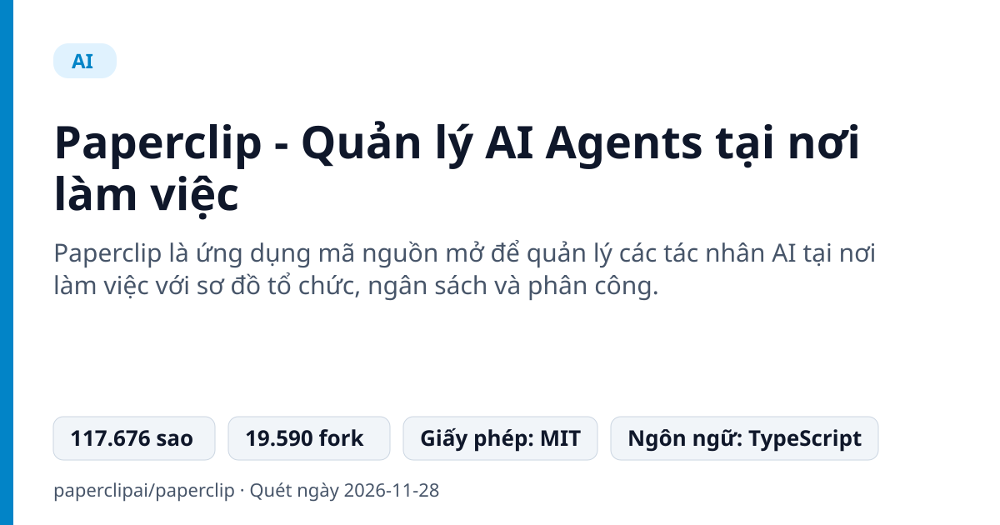
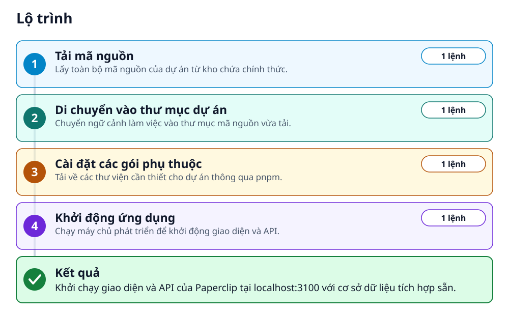
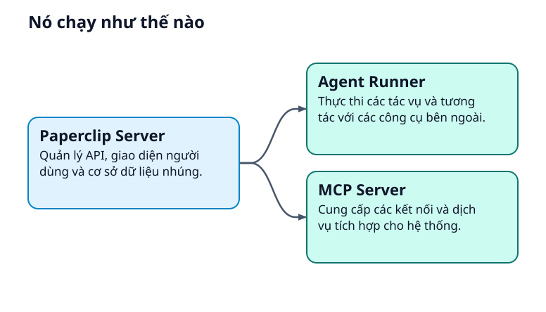
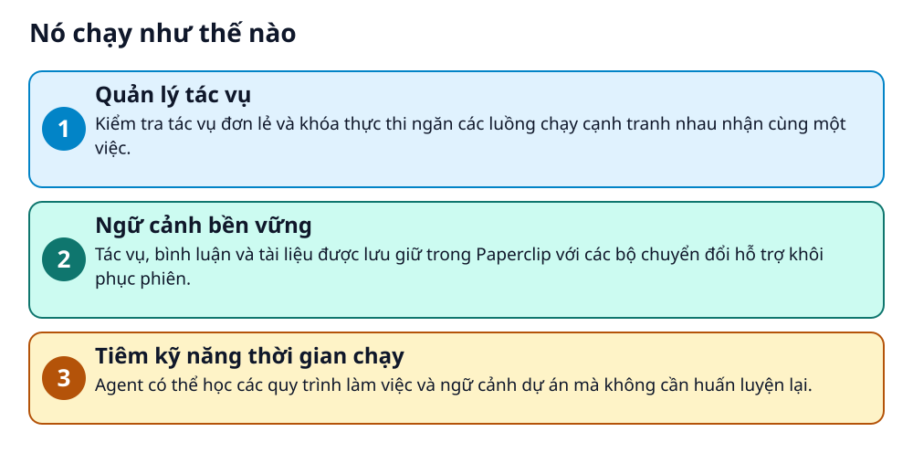

# Paperclip - Quản lý AI Agents tại nơi làm việc



> Ứng dụng mã nguồn mở giúp bạn quản lý các AI agents như một doanh nghiệp thực thụ.

**Paperclip là ứng dụng mã nguồn mở để quản lý các tác nhân AI tại nơi làm việc với sơ đồ tổ chức, ngân sách và phân công.**

## 🎯 Bạn sẽ làm ra được gì

Khởi chạy giao diện và API của Paperclip tại localhost:3100 với cơ sở dữ liệu tích hợp sẵn.

## Vấn đề nó giải quyết

Việc điều phối nhiều AI agent gặp khó khăn trong việc kiểm soát trùng lặp tác vụ, quản lý chi phí và duy trì ngữ cảnh. Thiếu sự quản trị tập trung khiến các nhóm không thể giám sát hiệu quả công việc của agent.

> 💡 **Hình dung đời thường:** Giống như việc quản lý một đội ngũ nhân sự ảo có sếp, chức vụ, bảng lương và sơ đồ tổ chức rõ ràng.

## Ai nên xem

- Nhà phát triển muốn điều phối nhiều AI agent cùng lúc
- Quản lý dự án cần tự động hóa công việc bằng AI
- Người dùng muốn kiểm soát chi phí và ngân sách của AI agent

## ⚠️ Lưu ý trước khi dùng

- Dự án đang trong giai đoạn phát triển nhanh, có thể có thay đổi
- Yêu cầu Node.js và pnpm phiên bản mới
- Cần có khóa API của nhà cung cấp LLM để agent hoạt động đầy đủ

## 🧰 Chuẩn bị trước khi bắt đầu

_Đánh dấu từng mục khi đã có đủ._

- [ ] **Node.js 24.11+**: Cần thiết để chạy các lệnh quản lý và ứng dụng.  
  <sub>Căn cứ: `README`</sub>
- [ ] **pnpm 9.15+**: Trình quản lý gói cho mã nguồn.  
  <sub>Căn cứ: `README`</sub>

## 🗺️ Lộ trình



## 🪜 Làm theo từng bước

### Bước 1 · Tải mã nguồn

**Mục đích:** Lấy toàn bộ mã nguồn của dự án từ kho chứa chính thức.

1. Mở terminal và sao chép kho chứa dự án từ GitHub.

_Gõ hoặc dán từng dòng, theo thứ tự._

```bash
git clone https://github.com/paperclipai/paperclip.git
```

✅ **Bạn sẽ thấy:** Thư mục paperclip được tạo với mã nguồn bên trong.

🩹 **Nếu không được:** Kiểm tra lại kết nối mạng hoặc Git đã được cài đặt chưa.

<sub>Căn cứ: `README`</sub>

### Bước 2 · Di chuyển vào thư mục dự án

**Mục đích:** Chuyển ngữ cảnh làm việc vào thư mục mã nguồn vừa tải.

1. Chạy lệnh để chuyển thư mục trong terminal.

```bash
cd paperclip
```

✅ **Bạn sẽ thấy:** Terminal trỏ đến thư mục paperclip.

🩹 **Nếu không được:** Đảm bảo lệnh clone trước đó đã hoàn tất thành công.

<sub>Căn cứ: `README`</sub>

### Bước 3 · Cài đặt các gói phụ thuộc

**Mục đích:** Tải về các thư viện cần thiết cho dự án thông qua pnpm.

1. Chạy lệnh cài đặt gói trong thư mục dự án.

```bash
pnpm install
```

✅ **Bạn sẽ thấy:** Các gói phụ thuộc được tải về và cài đặt hoàn tất.

🩹 **Nếu không được:** Kiểm tra phiên bản pnpm có đúng yêu cầu không.

<sub>Căn cứ: `README`</sub>

### Bước 4 · Khởi động ứng dụng

**Mục đích:** Chạy máy chủ phát triển để khởi động giao diện và API.

1. Chạy lệnh khởi động trong terminal.

```bash
pnpm dev
```

🔗 Mở địa chỉ: `http://localhost:3100`

✅ **Bạn sẽ thấy:** Giao diện và API bắt đầu chạy tại localhost:3100.

🩹 **Nếu không được:** Kiểm tra các bước cài đặt trước đó có gặp lỗi không.

<sub>Căn cứ: `README`</sub>

## ✔️ Kiểm tra kết quả

Truy cập trình duyệt để xem giao diện và API đang hoạt động.

## 🩹 Lỗi thường gặp

| Hiện tượng | Cách xử lý | Căn cứ |
|---|---|---|
| Lỗi E404 khi dùng npx với registry riêng | Chạy lại lệnh với tham số registry công khai. | `README` |

## 🚀 Làm tiếp

- Cấu hình các dự án và agent đầu tiên
- Khám phá các tính năng quản trị ngân sách và quy trình phê duyệt

## 🔍 Bên trong nó hoạt động ra sao





1. **Quản lý tác vụ**: Kiểm tra tác vụ đơn lẻ và khóa thực thi ngăn các luồng chạy cạnh tranh nhau nhận cùng một việc. _(Căn cứ: `README`)_
2. **Ngữ cảnh bền vững**: Tác vụ, bình luận và tài liệu được lưu giữ trong Paperclip với các bộ chuyển đổi hỗ trợ khôi phục phiên. _(Căn cứ: `README`)_
3. **Tiêm kỹ năng thời gian chạy**: Agent có thể học các quy trình làm việc và ngữ cảnh dự án mà không cần huấn luyện lại. _(Căn cứ: `README`)_

### Các mảnh ghép

| | Các mảnh ghép | Căn cứ |
|---|---|---|
| **Paperclip Server** | Quản lý API, giao diện người dùng và cơ sở dữ liệu nhúng. | `README` |
| **Agent Runner** | Thực thi các tác vụ và tương tác với các công cụ bên ngoài. | `README` |
| **MCP Server** | Cung cấp các kết nối và dịch vụ tích hợp cho hệ thống. | `README` |

## Học được gì từ thiết kế này

- Cách tổ chức nhiều AI agent thành một cấu trúc công ty có phân cấp rõ ràng
- Tầm quan trọng của việc khóa tác vụ nguyên tử để tránh xung đột
- Phương pháp kiểm soát ngân sách và quản trị quy trình làm việc của AI

## Từ khóa

- **Agent**: Tác nhân AI tự động thực hiện các công việc được giao.
- **Heartbeat**: Tín hiệu định kỳ đánh thức agent để kiểm tra công việc mới.
- **Org Chart**: Sơ đồ tổ chức thể hiện mối quan hệ báo cáo giữa các agent.

---

Nguồn dữ kiện: [paperclipai/paperclip](https://github.com/paperclipai/paperclip) · Giấy phép: MIT · 117.676 sao · Quét ngày 2026-11-28

_Nội dung do AI tóm tắt từ README và cấu trúc repo; hãy đọc repo gốc trước khi dùng._
